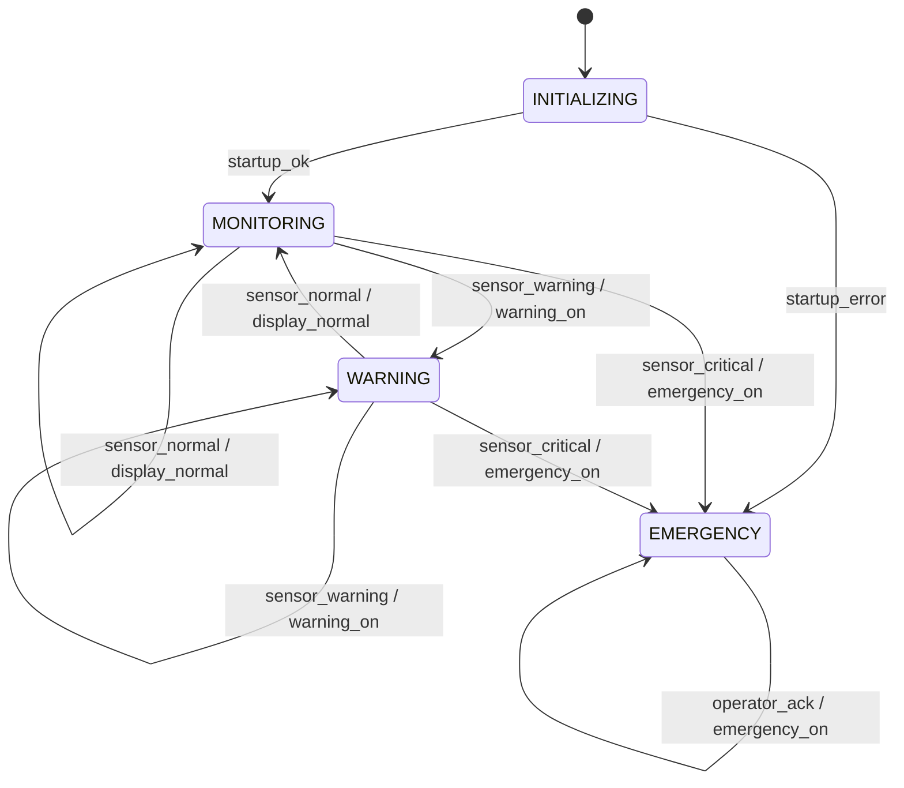

# HW-01: Basic Finite State Machine (FSM)

## 1. Introduction

This assignment presents a basic Finite State Machine (FSM) for a Patient Vital Signs Monitoring System. The system receives classified patient measurements and changes its state according to the observed conditions.

The purpose of this model is to demonstrate the basic concepts of discrete systems, states, inputs, outputs, and transitions.

This is a simplified educational model. It is not intended for clinical diagnosis or real-world medical decision-making.

## 2. Discrete System

A discrete system is a system whose behavior is described through distinct states and changes between those states in response to events or inputs.

In this project, the monitoring system evaluates incoming measurement classifications and updates its operating state. For example, the system can move from normal monitoring to a warning state when an abnormal condition is detected.

For simplicity, the sensor measurements are assumed to be classified as normal, warning, or critical before they reach the FSM. The actual medical thresholds and sensor-processing algorithms are outside the scope of this assignment.

## 3. System Inputs

The FSM receives the following inputs:

| Input | Description |
|---|---|
| `startup_ok` | System initialization has completed successfully. |
| `startup_error` | An initialization error has been detected. |
| `sensor_normal` | The latest measurement has been classified as normal. |
| `sensor_warning` | The latest measurement has been classified as requiring a warning. |
| `sensor_critical` | The latest measurement has been classified as critical. |
| `operator_ack` | An operator acknowledges the active emergency alert. |

The three sensor classification inputs represent alternative outcomes for a measurement evaluation.

## 4. System Outputs

The system produces the following outputs:

| Output | Description |
|---|---|
| `display_normal` | Displays the normal monitoring status. |
| `warning_on` | Activates the warning indication. |
| `emergency_on` | Activates or maintains the emergency indication. |

These outputs represent simplified logical signals. They do not specify the physical hardware or user interface.

## 5. FSM States

The system has four main states:

| State | Description |
|---|---|
| `INITIALIZING` | The system is starting and checking whether initialization succeeds. |
| `MONITORING` | The system is monitoring measurements classified as normal. |
| `WARNING` | An abnormal but non-critical measurement has been detected. |
| `EMERGENCY` | A critical condition or initialization error has been detected. The emergency state remains active until a recovery mechanism is defined in a later version. |

The initial state is `INITIALIZING`.

## 6. State Transitions

A transition occurs when an input or event causes the system to move from its current state to another state, or to remain in the same state.

The main transition rules are:

- After successful initialization, the system enters `MONITORING`.
- If initialization fails, the system enters `EMERGENCY`.
- During normal monitoring, a normal measurement keeps the system in `MONITORING`.
- A warning-level measurement moves the system to `WARNING`.
- A critical measurement moves the system to `EMERGENCY`, regardless of whether the system was monitoring normally or displaying a warning.
- In the `WARNING` state, a normal measurement returns the system to `MONITORING`.
- In the `WARNING` state, another warning-level measurement keeps the system in `WARNING`.
- In the `EMERGENCY` state, the emergency indication remains active. Acknowledging the alert does not automatically clear the emergency state.

## 7. State Diagram

The following diagram illustrates the basic FSM using Mermaid syntax.

In the diagram, each arrow represents a transition. The text on an arrow identifies the triggering input and, where specified, the associated output.

The emergency state has no exit transition in this initial model. A recovery procedure can be introduced in a future assignment.

## 8. State Transition Table

The following table provides a structured description of the transitions shown in the diagram.

| Current State | Input or Condition | Next State | Output or Action |
|---|---|---|---|
| `INITIALIZING` | `startup_ok` | `MONITORING` | Begin normal monitoring |
| `INITIALIZING` | `startup_error` | `EMERGENCY` | `emergency_on` |
| `INITIALIZING` | Initialization still in progress | `INITIALIZING` | Continue initialization |
| `MONITORING` | `sensor_normal` | `MONITORING` | `display_normal` |
| `MONITORING` | `sensor_warning` | `WARNING` | `warning_on` |
| `MONITORING` | `sensor_critical` | `EMERGENCY` | `emergency_on` |
| `WARNING` | `sensor_normal` | `MONITORING` | `display_normal` |
| `WARNING` | `sensor_warning` | `WARNING` | `warning_on` |
| `WARNING` | `sensor_critical` | `EMERGENCY` | `emergency_on` |
| `EMERGENCY` | `sensor_normal` | `EMERGENCY` | Maintain `emergency_on` |
| `EMERGENCY` | `sensor_warning` | `EMERGENCY` | Maintain `emergency_on` |
| `EMERGENCY` | `sensor_critical` | `EMERGENCY` | Maintain `emergency_on` |
| `EMERGENCY` | `operator_ack` | `EMERGENCY` | Maintain `emergency_on` |

The initialization-in-progress row describes the system waiting for an initialization result. It does not introduce a new state.

## 9. Example System Behavior

Consider the following sequence:

1. The system starts in `INITIALIZING`.
2. Initialization succeeds, so the system enters `MONITORING`.
3. A warning-level measurement is received, and the system enters `WARNING`.
4. A normal measurement is received, and the system returns to `MONITORING`.
5. A critical measurement is received, and the system enters `EMERGENCY`.
6. An operator acknowledges the alert, but the system remains in `EMERGENCY`.

This sequence demonstrates how the FSM responds to inputs and how the emergency state is kept separate from normal monitoring.

## 10. Conclusion

In this assignment, a basic FSM was developed for a Patient Vital Signs Monitoring System. The model identifies the system's inputs, outputs, states, and transitions and represents its behavior using a state diagram and a transition table.

The FSM provides a foundation for the next assignment, in which the system will be extended with state variables, guard conditions, actions, and a timer.

## 11. Reference

Lee, E. A., and Seshia, S. A. *Introduction to Embedded Systems: A Cyber-Physical Systems Approach*.

**Scope note:** This project is an educational model and is not a clinically validated patient-monitoring system.
