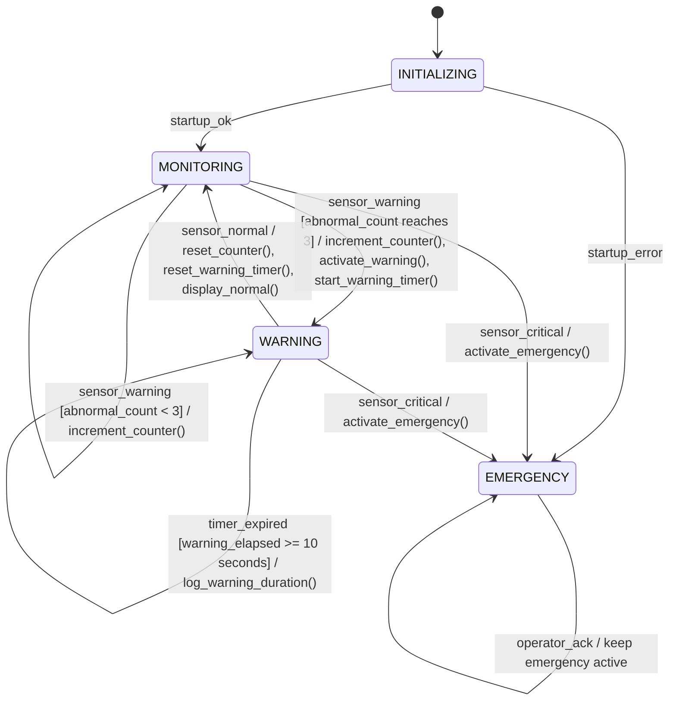

# HW-02: Extended Finite State Machine (EFSM)

## 1. Introduction

This assignment extends the basic Finite State Machine (FSM) developed in HW-01 for the Patient Vital Signs Monitoring System.

A basic FSM represents system behavior through states, inputs, outputs, and transitions. An Extended Finite State Machine (EFSM) adds state variables, guard conditions, actions, and timers to represent more detailed behavior.

In this assignment, the system uses a counter to track consecutive warning-level measurements and a timer to measure how long the system remains in the warning state.

This is a simplified educational model and is not intended for clinical diagnosis or real-world medical decision-making.

## 2. Review of the Previous FSM

The system has four main states:

| State | Description |
|---|---|
| `INITIALIZING` | The system checks whether initialization succeeds. |
| `MONITORING` | The system receives and evaluates classified measurements. |
| `WARNING` | Warning-level measurements have been detected. |
| `EMERGENCY` | A critical condition or initialization error has been detected. |

The system uses the following inputs:

- `startup_ok`
- `startup_error`
- `sensor_normal`
- `sensor_warning`
- `sensor_critical`
- `operator_ack`

The outputs include `display_normal`, `warning_on`, and `emergency_on`.

HW-02 preserves these states and basic behaviors while adding variables, guards, actions, and a timer.

## 3. State Variables

State variables store information that the system uses when making transition decisions.

This model introduces two variables.

| Variable | Initial Value | Description |
|---|---|---|
| `abnormal_count` | `0` | Counts consecutive warning-level measurements. |
| `warning_elapsed` | `0 seconds` | Tracks the elapsed time since the system entered the `WARNING` state. |

### 3.1. Abnormal Measurement Counter

When the system receives a warning-level measurement, it increments `abnormal_count`.

When a normal measurement is received, the counter is reset to zero.

A critical measurement causes an immediate transition to `EMERGENCY`, regardless of the counter value.

For this educational model, three consecutive warning-level measurements are required to trigger the warning state from normal monitoring.

### 3.2. Warning Timer

When the system enters `WARNING`, the warning timer starts at zero.

While the system remains in `WARNING`, the timer measures the elapsed time.

If the warning condition persists for 10 seconds, the system records a warning-duration event. It remains in `WARNING` unless a critical measurement causes an emergency transition.

The 10-second interval is an illustrative modeling parameter, not a medically validated threshold.

## 4. Guard Conditions

A guard is a condition that must be satisfied before a transition can occur.

The EFSM uses the following guards:

| Guard | Meaning | Result |
|---|---|---|
| `abnormal_count >= 3` | Three consecutive warning-level measurements have been received. | Enter `WARNING`. |
| `sensor_critical == true` | The latest measurement is classified as critical. | Enter `EMERGENCY` immediately. |
| `warning_elapsed >= 10 seconds` | The warning state has lasted at least 10 seconds. | Record a warning-duration event. |
| `sensor_normal == true` | The latest measurement is classified as normal. | Reset the counter and return to `MONITORING` from `WARNING`. |

The critical-condition guard has priority over the warning counter. A critical measurement must not wait for three warning-level measurements.

## 5. Actions

Actions are operations performed when an event occurs or a transition is taken.

| Action | Description |
|---|---|
| `increment_counter()` | Increases `abnormal_count` by one. |
| `reset_counter()` | Sets `abnormal_count` to zero. |
| `start_warning_timer()` | Starts the warning timer when entering `WARNING`. |
| `reset_warning_timer()` | Resets the warning timer when leaving `WARNING`. |
| `activate_warning()` | Activates the warning indicator. |
| `activate_emergency()` | Activates the emergency indicator. |
| `display_normal()` | Displays the normal monitoring status. |
| `log_warning_duration()` | Records that the warning state has persisted for the configured interval. |

For each warning-level sample, the system increments the counter before checking whether the counter has reached three.

## 6. Extended FSM Behavior

The updated model follows these rules:

1. After successful initialization, the system enters `MONITORING`.
2. In `MONITORING`, a normal measurement keeps the system in that state and resets the abnormal counter.
3. A warning-level measurement increments the counter. If the counter reaches three, the system enters `WARNING`.
4. If the counter has not yet reached three, the system remains in `MONITORING`.
5. A critical measurement causes an immediate transition to `EMERGENCY`.
6. On entering `WARNING`, the system activates the warning indicator and starts the timer.
7. While in `WARNING`, further warning-level measurements keep the system in that state.
8. If a normal measurement is received in `WARNING`, the system returns to `MONITORING`, resets the counter, and resets the warning timer.
9. If the warning timer reaches 10 seconds, the system records a warning-duration event.
10. If a critical measurement occurs in `WARNING`, the system enters `EMERGENCY` immediately.
11. In `EMERGENCY`, the emergency indicator remains active. An operator acknowledgment alone does not clear the emergency state.

## 7. EFSM State Diagram

The following Mermaid diagram shows the main states and the extended transition behavior.

**Diagram note:** The labels describe the intended behavior. The counter is incremented before the threshold is checked, so the transition to `WARNING` occurs on the third consecutive warning-level measurement. The timer-expiration event is evaluated while the system is in `WARNING`.

## 8. State Transition Table

| Current State | Input or Guard | Next State | Action |
|---|---|---|---|
| `INITIALIZING` | `startup_ok` | `MONITORING` | Begin monitoring |
| `INITIALIZING` | `startup_error` | `EMERGENCY` | `activate_emergency()` |
| `MONITORING` | `sensor_normal` | `MONITORING` | `reset_counter()`, `display_normal()` |
| `MONITORING` | `sensor_warning`, count below 3 | `MONITORING` | `increment_counter()` |
| `MONITORING` | Third consecutive `sensor_warning` | `WARNING` | Increment counter, activate warning, start timer |
| `MONITORING` | `sensor_critical` | `EMERGENCY` | `activate_emergency()` |
| `WARNING` | `sensor_warning`, timer below 10 seconds | `WARNING` | Keep warning active |
| `WARNING` | Timer reaches 10 seconds | `WARNING` | `log_warning_duration()` |
| `WARNING` | `sensor_normal` | `MONITORING` | Reset counter and timer; display normal |
| `WARNING` | `sensor_critical` | `EMERGENCY` | `activate_emergency()` |
| `EMERGENCY` | Any listed sensor input | `EMERGENCY` | Keep emergency active |
| `EMERGENCY` | `operator_ack` | `EMERGENCY` | Keep emergency active |

## 9. Example Execution

Consider the following sequence of classified measurements:

| Step | Input | Counter | State After Processing |
|---|---|---:|---|
| 1 | `startup_ok` | 0 | `MONITORING` |
| 2 | `sensor_warning` | 1 | `MONITORING` |
| 3 | `sensor_warning` | 2 | `MONITORING` |
| 4 | `sensor_warning` | 3 | `WARNING` |
| 5 | Warning persists for 10 seconds | 3 | `WARNING` |
| 6 | `sensor_normal` | 0 | `MONITORING` |
| 7 | `sensor_critical` | 0 | `EMERGENCY` |

This example demonstrates how a counter can prevent a single warning-level sample from immediately triggering the warning state, while a critical measurement still triggers an immediate emergency response.

The example assumes that each row represents one completed measurement-processing event and that the timer runs while the system remains in `WARNING`.

## 10. Comparison: FSM and EFSM

| Feature | Basic FSM | Extended FSM |
|---|---|---|
| States | Yes | Yes |
| Inputs and transitions | Yes | Yes |
| State variables | Not explicitly used in the basic model | Used to store additional information |
| Guard conditions | Basic input-driven transitions | Conditions can determine whether transitions are allowed |
| Actions | Simple outputs can be associated with transitions | More detailed operations can be performed |
| Timers | Not included in the basic model | Can represent elapsed time and timeout events |

The EFSM makes the model more expressive without requiring a separate state for every possible counter value or elapsed-time value.

## 11. Conclusion

In this assignment, the basic FSM from HW-01 was extended with two state variables, guard conditions, actions, and a timer.

The abnormal measurement counter tracks consecutive warning-level measurements, while the warning timer tracks how long the system remains in the warning state. Guard conditions determine when the system changes states, and actions specify the operations performed during transitions.

This extended model provides a foundation for HW-03, where the monitoring logic and safety management will be represented as separate interacting state machines.

## 12. Reference

Lee, E. A., and Seshia, S. A. *Introduction to Embedded Systems: A Cyber-Physical Systems Approach*.

**Safety note:** This is an educational model. Its example counter and timer settings are not clinically validated and must not be used as medical operating thresholds.
