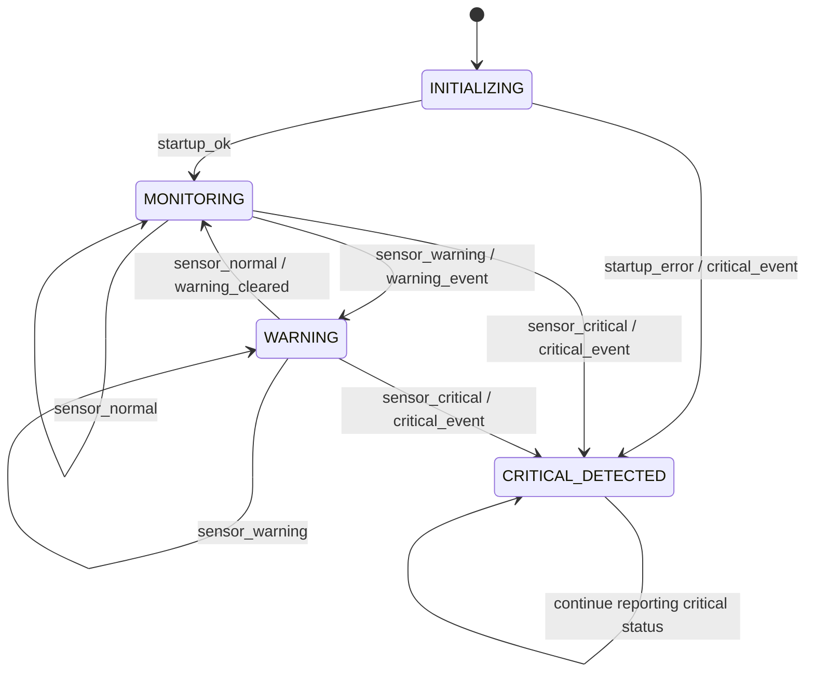

# HW-03: Composition of State Machines

## 1. Introduction

This assignment extends the Patient Vital Signs Monitoring System developed in HW-01 and HW-02 by introducing the composition of multiple state machines.

As the system becomes more complex, managing all behavior in a single state machine can make the model difficult to understand and maintain. To improve clarity, the system is divided into two cooperating state machines:

- **Monitoring FSM:** Processes classified patient measurements and identifies normal, warning, and critical conditions.
- **Safety FSM:** Manages warning indications, emergency mode, and the recovery process.

The two state machines have separate responsibilities but communicate through events. This design illustrates how concurrent system behavior can be represented using concepts from embedded systems and cyber-physical systems.

This is an educational model, not a clinically validated patient-monitoring system.

## 2. System Architecture

The system contains two logical components.

| Component | Main Responsibility | Important Outputs |
|---|---|---|
| Monitoring FSM | Evaluates incoming measurement classifications | `warning_event`, `warning_cleared`, `critical_event` |
| Safety FSM | Controls the system's safety mode | `warning_on`, `emergency_on`, `recovery_permitted` |

The Monitoring FSM determines what condition has been detected. The Safety FSM determines how the system should respond to that condition.

For example, when the Monitoring FSM detects a critical measurement, it generates `critical_event`. The Safety FSM receives this event and enters `EMERGENCY`.

The Safety FSM does not need to repeat the sensor-classification logic. It responds to events produced by the Monitoring FSM.

## 3. State Machine A: Monitoring FSM

The Monitoring FSM is responsible for monitoring the patient's classified measurements.

### 3.1. States

| State | Description |
|---|---|
| `INITIALIZING` | The monitoring component is starting. |
| `MONITORING` | Measurements are being evaluated under normal monitoring operation. |
| `WARNING` | A warning-level condition has been detected. |
| `CRITICAL_DETECTED` | A critical condition has been detected. |

### 3.2. Inputs

The Monitoring FSM receives:

- `startup_ok`
- `startup_error`
- `sensor_normal`
- `sensor_warning`
- `sensor_critical`

### 3.3. Events Sent to the Safety FSM

| Event | Meaning |
|---|---|
| `warning_event` | A warning condition has been detected. |
| `warning_cleared` | The system has returned from the warning state to normal monitoring. |
| `critical_event` | A critical condition has been detected. |

### 3.4. Monitoring FSM Diagram

The Monitoring FSM detects conditions and publishes events. It does not independently deactivate the emergency indication.

The `CRITICAL_DETECTED` state remains active in this simplified model once a critical condition has been detected. A separate recovery procedure would be needed to
